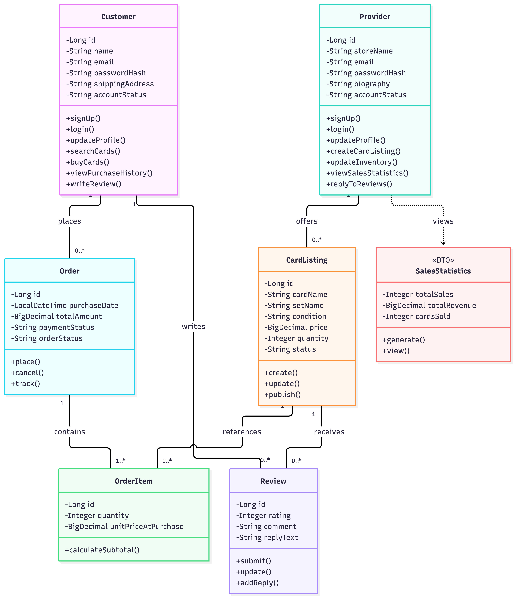

# PokeVerse Backend API

## Project Description

PokeVerse is an online marketplace for buying and
selling Pokémon trading cards.

The backend uses Java 25, Spring Boot, Spring Data JPA,
and PostgreSQL hosted on Neon.

## Team Responsibilities

- Ziyad: Customer Backend API
- Anuraj: Provider Backend API

## UML Class Diagram



## Customer API Endpoints

| Use Case | Method | Endpoint | Success | Developer |
|---|---|---|---|---|
| Create Customer | POST | /api/customers | 201 | Ziyad |
| View Profile | GET | /api/customers/{id} | 200 | Ziyad |
| Update Profile | PUT | /api/customers/{id} | 200 | Ziyad |

## Example POST Request

Endpoint: POST /api/customers

```json
{
  "name": "Test Customer",
  "email": "test@example.com",
  "password": "TestPassword123!",
  "shippingAddress": "Greensboro, NC"
}
```

## Example PUT Request

Endpoint: PUT /api/customers/1

```json
{
  "name": "Updated Customer",
  "email": "updated@example.com",
  "shippingAddress": "Charlotte, NC"
}
```

## HTTP Status Codes

- 201: Customer created successfully
- 200: Customer retrieved or updated
- 400: Invalid request data
- 404: Customer not found
- 409: Email already registered

## Database

The backend uses Neon PostgreSQL.

Development branches:
- customer-dev
- provider-dev

Main database branch:
- production

Database credentials are configured through
environment variables and are never committed
to GitHub.

## Testing

Customer Profile API tested successfully:

- POST /api/customers
- GET /api/customers/{id}
- PUT /api/customers/{id}
- Invalid input (400)
- Missing customer (404)

Customer data persistence was verified in Neon.

## Remaining Features

Customer:
- Browse and search card listings
- Place orders and view purchase history
- Write and update reviews

Provider:
- Provider profile management
- Card listing management
- Inventory management
- Sales statistics
- Review replies


## Customer Orders & Purchase History API (Issue #15)

Developer: Ziyad

### API Endpoints

| Method | Endpoint | Description |
|---|---|---|
| POST | /api/orders | Place a customer order |
| GET | /api/orders/customer/{customerId} | View purchase history |
| GET | /api/orders/{orderId} | View an individual order |

### Features

- Create customer orders containing multiple cards.
- Verify customer and card IDs.
- Validate requested quantities.
- Check available stock before completing an order.
- Calculate order totals.
- Reduce stock after a successful purchase.
- Save orders and order items in Neon PostgreSQL.
- Retrieve previous customer orders.

### Database Entities

- Order.java — Order details and total
- OrderItem.java — Purchased card details

### HTTP Status Codes

- 201 — Order placed
- 200 — Order retrieved
- 400 — Invalid order request
- 404 — Customer, card, or order not found
- 409 — Insufficient stock

### Testing

Test using curl and Neon SQL Editor.

Development database: customer-dev

Note: Authentication and real payment processing
are not implemented in this milestone.


## Customer Reviews API (Issue #16)

Developer: Ziyad

### API Endpoints

| Method | Endpoint | Description |
|---|---|---|
| POST | /api/reviews | Create a review |
| PUT | /api/reviews/{reviewId} | Update a review |
| GET | /api/reviews/{reviewId} | View one review |
| GET | /api/reviews/card/{cardListingId} | View card reviews |
| GET | /api/reviews/customer/{customerId} | View customer reviews |

### Features

- Create reviews for Pokemon card listings.
- Rate cards from 1 to 5 stars.
- Update review ratings and comments.
- Retrieve reviews by card or customer.
- Store reviews in Neon PostgreSQL.
- Support future seller replies.

### Java Classes

- Review.java
- ReviewRepository.java
- CreateReviewRequest.java
- UpdateReviewRequest.java
- ReviewResponse.java
- ReviewService.java
- ReviewController.java

### Testing

- Review retrieval: 200 OK
- Review update: 200 OK
- Review persistence: Verified in Neon SQL Editor

## Provider Backend API — Issues #22–#26

Developer: Anuraj Subedi

### API Endpoints

| Method | Endpoint | Description | Success |
|---|---|---|---|
| POST | /api/providers | Create Provider profile | 201 |
| GET | /api/providers/{providerId} | View Provider profile | 200 |
| PUT | /api/providers/{providerId} | Update Provider profile | 200 |
| DELETE | /api/providers/{providerId} | Delete empty Provider profile | 204 |

| POST | /api/providers/{providerId}/cards | Create listing | 201 |
| GET | /api/providers/{providerId}/cards | View own listings | 200 |
| GET | /api/providers/{providerId}/cards/{cardId} | View listing | 200 |
| PUT | /api/providers/{providerId}/cards/{cardId} | Update listing | 200 |
| DELETE | /api/providers/{providerId}/cards/{cardId} | Delete unused listing | 204 |

| PUT | /api/providers/{providerId}/cards/{cardId}/inventory | Update stock | 200 |
| GET | /api/providers/{providerId}/statistics | View sales statistics | 200 |
| GET | /api/providers/{providerId}/reviews | View buyer reviews | 200 |
| POST | /api/providers/{providerId}/reviews/{reviewId}/replies | Create reply | 201 |
| PUT | /api/providers/{providerId}/reviews/{reviewId}/replies | Update reply | 200 |

### Features and Use Cases

- Issue #22: Create, view, update, and remove Provider profiles.
- US-6 / Issue #23: Manage card listings.
- US-7 / Issue #24: Update inventory.
- US-8 / Issue #25: View sales, revenue, quantities sold, and unique customers.
- US-9 / Issue #26: Read buyer reviews and manage seller replies.

These Provider features are now implemented.

### Example Request Bodies

POST /api/providers:

```json
{
  "storeName": "Anuraj PokeVerse Store",
  "email": "anuraj@example.com",
  "password": "DemoPassword123!",
  "biography": "Pokemon pack seller."
}
```

PUT /api/providers/{providerId}:

```json
{
  "storeName": "Anuraj Sealed Packs",
  "email": "anuraj@example.com",
  "biography": "Updated seller information."
}
```

POST /api/providers/{providerId}/cards and
PUT /api/providers/{providerId}/cards/{cardId}:

```json
{
  "name": "Booster Pack",
  "description": "Factory-sealed Pokemon pack.",
  "condition": "Sealed",
  "price": 14.00,
  "stock": 25,
  "imageUrl": ""
}
```

PUT /api/providers/{providerId}/cards/{cardId}/inventory:

```json
{
  "stock": 30
}
```

POST and PUT /api/providers/{providerId}/reviews/{reviewId}/replies:

```json
{
  "sellerReply": "Thank you for your order!"
}
```

### Shared Entities

- Provider — Seller profile.
- CardListing — Listing details and inventory.
- Order and OrderItem — Sales statistics.
- Review — Buyer feedback, sellerReply, and repliedAt.

The Provider API reuses the existing shared entities and repositories.

### Testing

API client: EchoAPI.
Development database: provider-dev.

- Profile, listing, inventory, statistics, and reply operations.
- Invalid input: 400.
- Missing records: 404.
- Duplicate emails/replies and protected deletions: 409.
- Verify saved records in Neon and after application restart.

### Deployment

Live Render URL: https://pokeverse-fk54.onrender.com/api/cards

Root Directory: backend-api.
Production database branch: production.

The first request after inactivity may take about one minute.